# Wildfire Drone Response

**A simulation of early wildfire detection and drone suppression.** Thermal cameras on mountain peaks find a fire, a
central computer forecasts where it is going, and a fleet of 15 quadrotors cuts off the advancing fire line, so that
the fire is held automatically, within minutes, until aircraft arrive (if they are needed at all).

*Four fires start at the same time, two of them in blind spots. The simulation window, full flight dynamics;
playback 16× while drones fly, 32× otherwise.*

> **Simulation only.** Nothing here has been tested on hardware, and the fire model is not calibrated against real
> fires. Absolute numbers are not predictions; see *Limitations*.

> **Source code:** kept private. This repository holds the report, the figures and the videos. If you would like to discuss the work, contact me on LinkedIn.  
> © 2026 Halil Öztürk. All rights reserved; no licence is granted to copy or reuse the contents.

**Contents:** [How it works](#how-it-works) · [The simulation window](#the-simulation-window) ·
[Demo missions](#demo-missions) · [Mathematical models](#mathematical-models) · [Studies](#studies) ·
[Limitations](#limitations)

## How it works

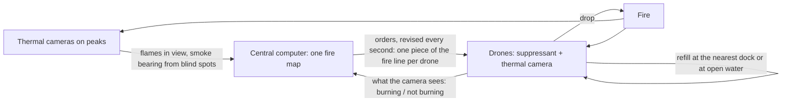

- **Detection.** Three towers on the highest peaks scan their viewshed every 4 s. Ground they cannot see is a
  *blind spot* (about 29 % of the land on the dry map). A fire there is still found once its **smoke column**
  rises above the ridge into a tower's view: that gives a bearing, not a position.
- **Nobody patrols.** No drone is in the air unless there is a fire or smoke to look at. For smoke that no known
  fire explains, **one drone**, the one that can be there first, flies along the bearing high enough for a wide
  camera footprint. The moment it sees the fire, the fire is on the common map and the fleet is sent to it.
- **One fire map.** Every tower and every drone camera reports to the centre (1 s radio delay). Cameras report
  both "burning" and "not burning", so the map also learns where the fire has gone out.
- **Aim at the fire line, not at the fire.** The centre forecasts when the fire will reach each cell and values a
  drop by **the spread it stops**. The burnt-out centre is worth nothing; the head of the fire (uphill, downwind)
  is worth most. Each drone gets its own piece of the line, so nobody flies to ground that will be wet before the
  fire gets there.
- **Orders are revised in flight.** Every drone's order is checked again while it flies; a target that is no
  longer worth a charge is withdrawn and the drone gets another piece, at the same fire or at another one, or
  turns round. Every fire gets its first drone before any fire gets more.
- **Refilling and going home.** A drone that is empty or low on battery goes to the **nearest dock** (battery swap
  and two new charges, 120 s), whichever tower it belongs to, or fills its tank at **open water** (20 s) when that
  is faster. One loaded drone waits over an active fire to answer a flare-up in seconds. When no fire is left,
  every drone flies back to its own base.

## The simulation window

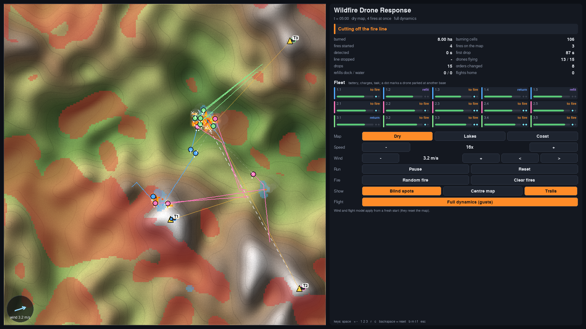

*Four fires, 300 s after ignition. Red areas are blind spots, triangles are towers with their drone docks, dashed
lines show where each drone is being sent. The panel shows every drone's task, battery and charges.*

The window (pygame) is the simulation itself, not a replay: click on the map to start fires (as many as you like),
switch between three maps, change wind, speed and flight model, show the blind spots or the centre's own fire map.

## Demo missions

All three with the full 6-DOF flight model, 15 drones, wind 3.2 m/s.

| | 1. Four fires at once (dry map) | 2. One fire deep in a blind spot | 3. One blind-spot fire, lake map |
|---|---|---|---|
| Fire seen (tower or smoke) | 0.5 s | 280 s | 12 s |
| Fire on the common map | 0.5 s | 404 s | 36 s |
| First drop | 87 s | 471 s | 231 s |
| Fire line stopped | 460 s | 772 s | 432 s |
| Fire out | 658 s | 968 s | 732 s |
| Burned area | 8.6 ha | 5.8 ha | 4.4 ha |
| Drops | 30 | 18 | 13 |
| Orders changed in flight | 9 | 2 | 2 |
| Refills dock / water | 14 / 0 | 5 / 0 | 9 / 2 |

Demo 2 is the hard case for a fleet without patrols: the fire burns in a deep valley for 280 s
before its smoke rises into a tower's view.

### 1. Four fires at once

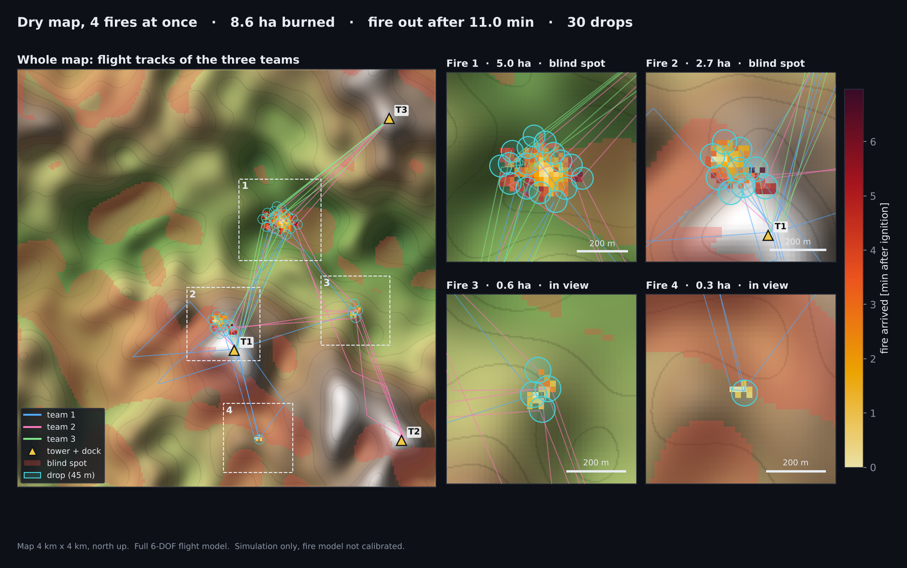

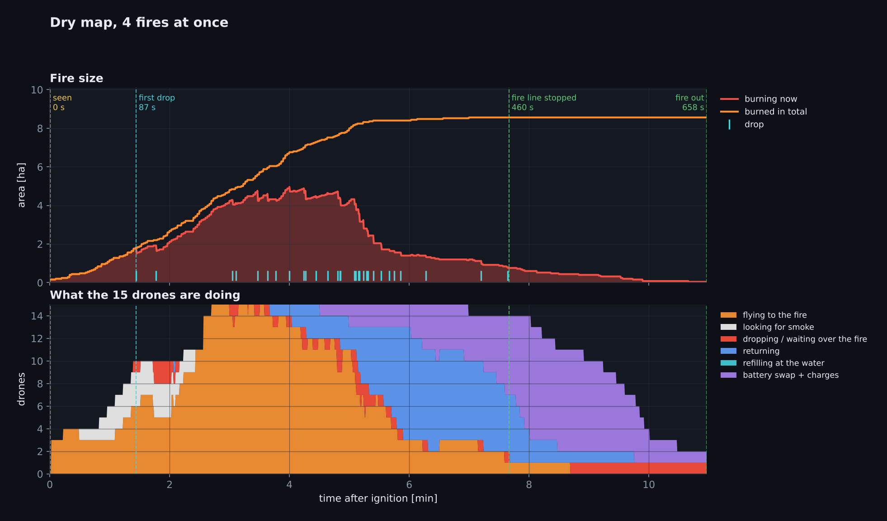

The upper plot shows the area burning and the area burned in total; the lower one what the 15 drones are doing at
every moment: the whole fleet is in the air within three minutes, the first drones are back for new charges after
five.

### 2. A fire deep in a blind spot

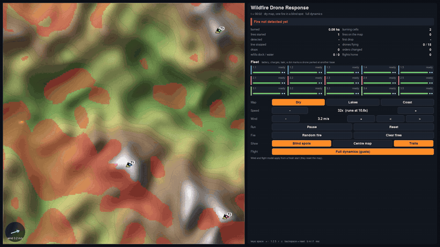

| Smoke seen, one drone goes to look | The fleet on the fire line |
|---|---|
| 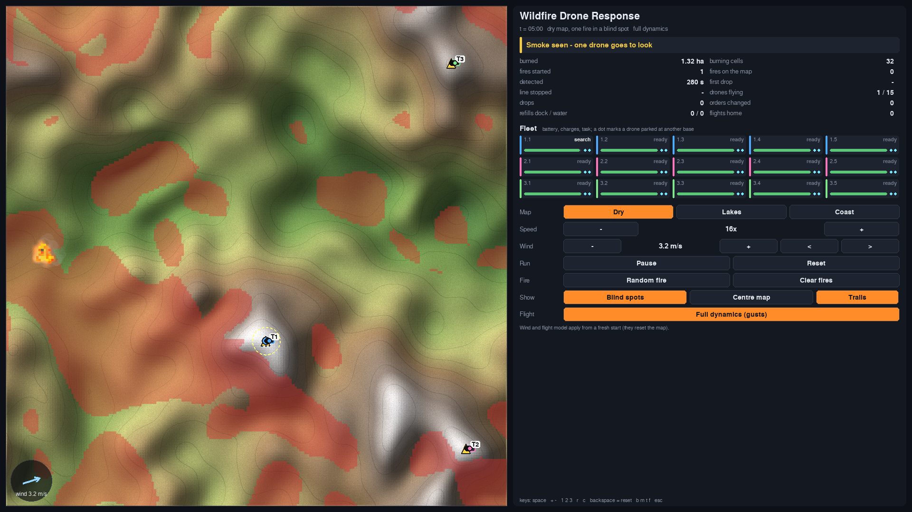 |  |

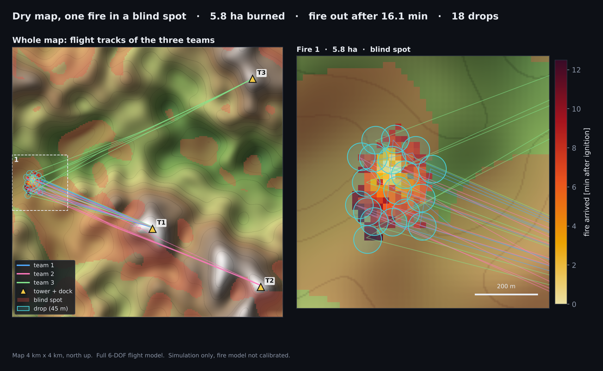

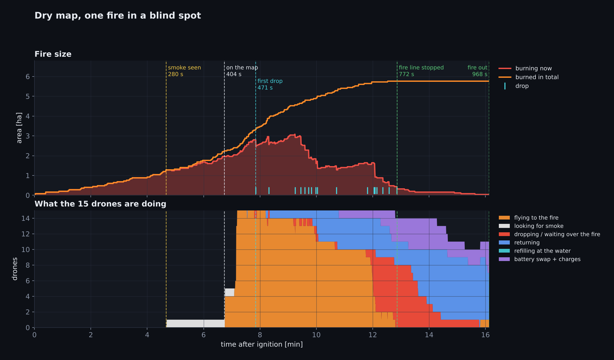

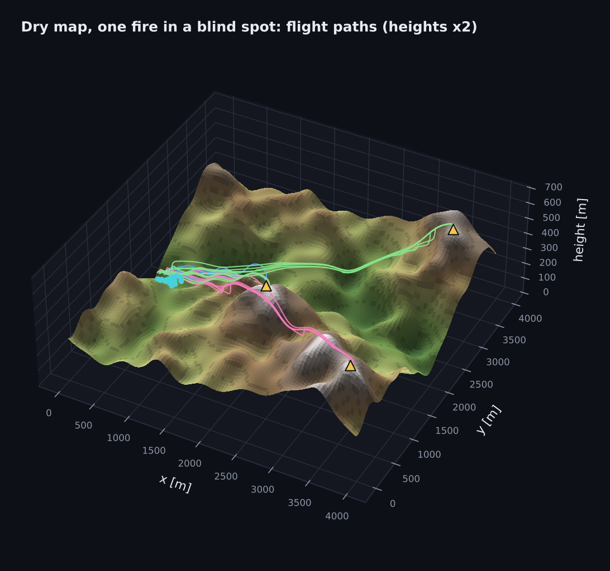

### 3. Lake map: refilling from open water

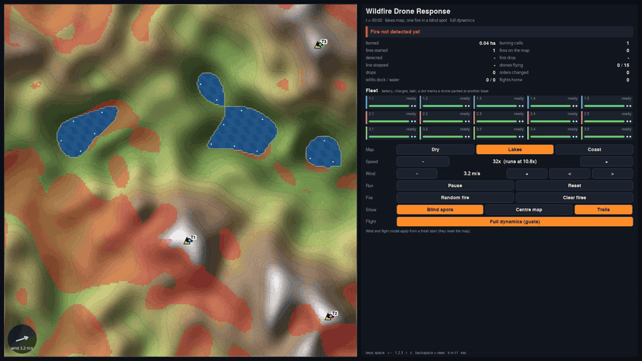

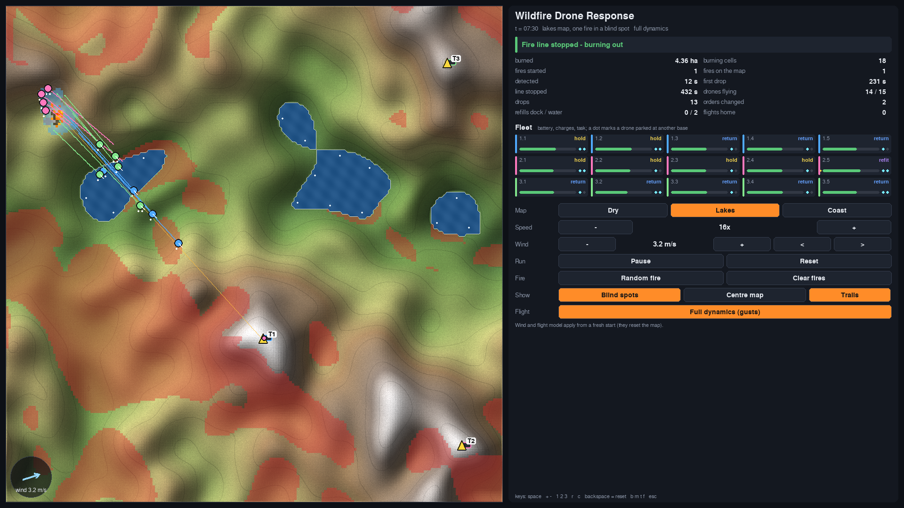

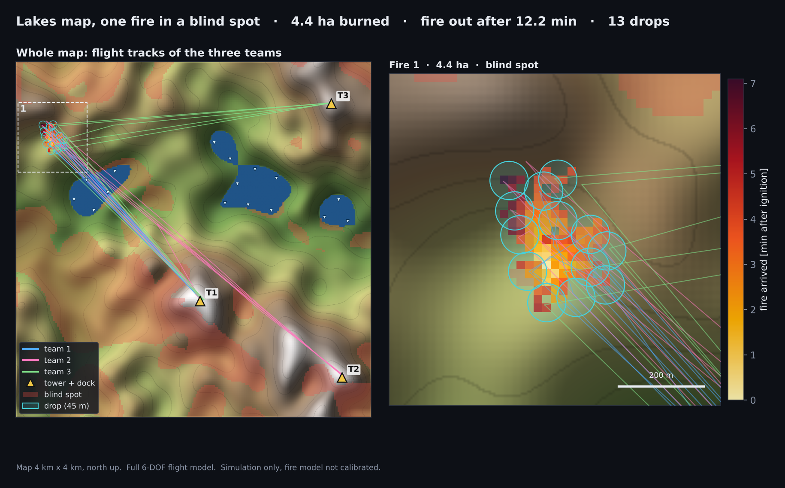

## Mathematical models

Everything runs on one grid: 200 × 200 cells of $c = 20$ m (4 km × 4 km). The mission advances in steps of
$\Delta t = 0.5$ s; the quadrotors are integrated at 100 Hz inside each step.

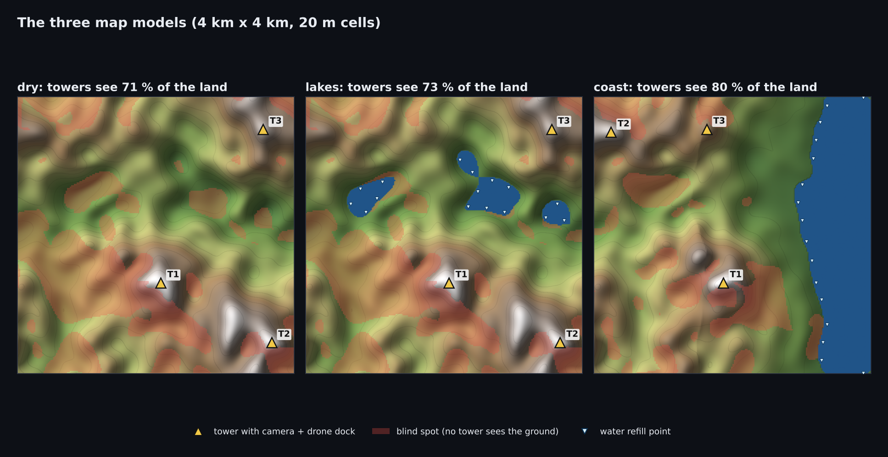

### Terrain

Fractal noise with a power-law spectrum, filtered in the Fourier domain:

$$
\hat z = \mathcal F^{-1}\left[(\xi_1 + i\,\xi_2)\,|k|^{-\beta/2}\,\mathbb 1(|k| \le 0.05)\right],\qquad
z = z_0 + R\,\tilde z^{\,1.15}
$$

with $\xi_{1,2} \sim \mathcal N(0,1)$, $\beta = 3$, $\tilde z$ the noise scaled to $[0, 1]$, valley floor $z_0 = 40$ m and
relief $R = 500$ m. *Lakes*: the lowest closed basins are flooded up to a level found by bisection (1–3 % of the
map each). *Coast*: the map is tilted towards one side until about 22 % lies below sea level.

### Fire: a stochastic cellular automaton

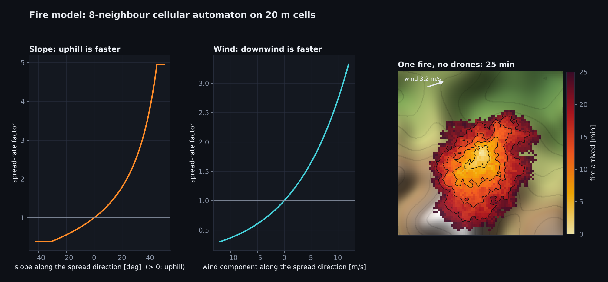

Each cell is unburnt, burning, burnt out or treated. A burning cell $i$ ignites its neighbour $j$ (8 neighbours) at the rate

$$
r_{ij} = \frac{f_i}{\tau_0\, d_{ij}}\;
\exp\!\big(k_s\,\mathrm{clip}(\tan\theta_{ij},\,-0.6,\,1)\big)\;
\exp\!\big(k_w\,\mathbf w\cdot\hat{\mathbf u}_{ij}\big)
$$

where $\tan\theta_{ij} = \nabla z\cdot\hat{\mathbf u}_{ij}$ is the slope towards $j$ (uphill is faster),
$\mathbf w$ the mean wind, $\hat{\mathbf u}_{ij}$ the unit vector from $i$ to $j$, $d_{ij} \in \{1, \sqrt2\}$
cells, $\tau_0 = 280$ s, $k_s = 1.6$, $k_w = 0.10$ s/m, and $f_i \in [0.7, 1.3]$ a smooth random fuel field.
In a step $\Delta t$ an unburnt cell catches fire with probability

$$
P_j = 1 - \exp\!\Big(-\Delta t \sum_{i \in \mathcal N(j),\ i\ \text{burning}} r_{ij}\Big)
$$

and then burns for a time drawn from $\mathcal U(240, 480)$ s. Open water never burns.
**A drop** of radius $R_d = 45$ m puts out every burning cell inside with probability 0.9 and makes every cell inside
non-flammable for 15 min. The constants are plausible, hand-chosen values, not a calibrated fire model.

### Towers, detection and smoke

A cell is in a tower's view if flames 2 m high clear the terrain along the line of sight from the camera (12 m mast,
range 3.5 km). In each 4-s scan a burning cell in view is detected with probability

$$
p(d) = 0.9\, \exp\!\big(-(d / 2.8\,\text{km})^2\big)
$$

and located with a common error of $\sigma = 0.0015\,\text{rad}\cdot d$ (1.5 m per km). A fire in a blind spot
of $n$ burning cells raises a smoke column of height

$$
h(n) = \min\big(18\sqrt n,\ 350\big)\ \text{m}
$$

and a tower sees it once $h$ exceeds the height a point over that cell must have to be in view. It then reports only
a **bearing** ($\sigma = 0.01$ rad, with probability 0.3 per scan). The centre's search area is the strip of blind
cells within $\pm(2.5\sigma + \arctan(0.7c/d))$ of the bearing; two towers seeing the same column narrow it to the
crossing of their strips.

### The central computer: belief, forecast and the value of a drop

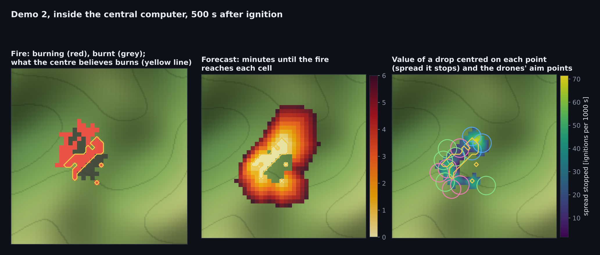

**Belief.** A cell is believed to burn if its last "burning" report is newer than its last "clear" look and younger
than the memory (45 s in view of a tower, 300 s in a blind spot).

**Forecast.** With the expected spread rates $\bar r_{ij}$ (fuel $f = 1$: the centre knows terrain and wind, not the
fuel) every edge of the grid gets a travel time $w_{ij} = \kappa / \bar r_{ij}$. The arrival time of the fire in
each cell is the shortest path from the believed fire,

$$
T_j = \min\Big(T_j,\ \min_{i \in \mathcal N(j)} \big(T_i + w_{ij}\big)\Big), \qquad T = 0 \text{ on burning cells},
$$

solved by repeated sweeps (Bellman–Ford) over a window around the fire, with water, wet and burnt cells blocked and a
6-min horizon. The factor $\kappa = 0.22$ is the one calibrated number: the random fire, which advances along many
paths at once, arrives after about 0.23 of the single-path time (median over 2 500 cells of 12 free-burning fires).

**Value.** Putting out cell $i$ at the moment $\tau$ the charge lands stops the spread into its unburnt neighbours:

$$
v_i(\tau) = \mathbb 1\big[T_i \le \tau < T_i + 480\,\text{s}\big] \sum_{j \in \mathcal N(i)} \bar r_{ij}\ \mathbb 1\big[T_j > \tau,\ j \text{ not blocked}\big]
$$

and a drop centred at $\mathbf x$ is worth $V(\mathbf x) = \sum_{i:\,|\mathbf x_i - \mathbf x| \le 0.9 R_d} v_i(\tau)$.

**Assignment.** Drones are served in order of arrival time. Each gets the point that maximises

$$
V(\mathbf x)\ \exp\!\left(-\frac{d(\mathbf x) - d_{\min}}{45\,\text{s}\cdot v}\right)
$$

($d$: flight distance, $v$: ground speed), aimed at the value-weighted centre of the disc. The forecast is then
recomputed with that drop in it (cells it wets before the fire arrives are blocked, fire inside it stops at impact),
so the next drone gets another piece. The whole plan is redone every second; an order that three checks in a row
find no longer worth a charge is withdrawn.

### Quadrotor dynamics

Each drone has 16 states: position $\mathbf p$, velocity $\mathbf v$, roll-pitch-yaw $\boldsymbol\eta$, body rates
$\boldsymbol\omega$ and the four rotor thrusts $f_k$:

$$
\begin{aligned}
\dot{\mathbf p} &= \mathbf v \\
m\,\dot{\mathbf v} &= R(\boldsymbol\eta)\,\mathbf e_3 \textstyle\sum_k f_k - m g\,\mathbf e_3 - \big(c_d\,|\mathbf v_r| + c_l\big)\,\mathbf v_r,
\qquad \mathbf v_r = \mathbf v - \mathbf w - \mathbf g \\
\dot{\boldsymbol\eta} &= W(\boldsymbol\eta)\,\boldsymbol\omega \\
J\,\dot{\boldsymbol\omega} &= \boldsymbol\tau - \boldsymbol\omega \times J\boldsymbol\omega,
\qquad \big[T,\ \boldsymbol\tau\big]^\top = M\,\mathbf f \\
\dot f_k &= \big(f_{k,\mathrm{cmd}} - f_k\big) / \tau_m
\end{aligned}
$$

$M$ maps the rotor thrusts to total thrust and torques (arm 0.30 m, yaw torque 0.016 m per newton). Mass 4.5 kg plus
2 × 1.5 kg of suppressant, $J = \mathrm{diag}(0.09, 0.09, 0.16)$ kg m², $f_{\max} = 28$ N per rotor,
$\tau_m = 30$ ms, $c_d = 0.06$ N s²/m², $c_l = 0.25$ N s/m. Integrated with RK4 at 100 Hz.

**Battery.** Momentum-theory power with a figure of merit, plus avionics, from a 260 Wh battery:

$$
P = \frac{T^{3/2}}{\mathrm{FM}\sqrt{2\rho A}} + P_{av}, \qquad \mathrm{FM} = 0.62,\ A = 0.55\ \text{m}^2,\ \rho = 1.2\ \text{kg/m}^3,\ P_{av} = 45\ \text{W}
$$

**Wind and gusts.** $\mathbf w$ is the mean wind (it also drives the fire and carries the falling charge). In the full
model every drone flies through its own gusts, a first-order Gauss–Markov process

$$
\dot{\mathbf g} = -\frac{\mathbf g}{\tau_g} + \sigma_g\sqrt{\frac{2}{\tau_g}}\ \boldsymbol\xi(t),
\qquad \tau_g = 2.5\ \text{s},\ \ \sigma_g = 0.25\,|\mathbf w| + 0.3\ \text{m/s}\ (\text{half vertically})
$$

### Control and guidance

A cascade, all loops at 100 Hz; the controller is **not told the wind**:

$$
\begin{aligned}
\mathbf v_{des} &= \mathbf v_{ref} + K_p(\mathbf p_{ref} - \mathbf p) \\
\mathbf a_{cmd} &= \mathbf a_{ff} + K_v\,\mathbf e_v + K_i\!\int\!\mathbf e_v\,dt - \hat{\mathbf d},
\qquad \mathbf e_v = \mathbf v_{des} - \mathbf v \\
\mathbf F_{des} &= m\,\mathbf a_{cmd} + m g\,\mathbf e_3 - \mathbf D_0(\mathbf v)
\ \ \to\ \ T,\ \phi_d,\ \theta_d \ \ (\text{tilt} \le 32^\circ \text{ loaded}) \\
\boldsymbol\tau &= J\big(K_\eta\,\mathbf e_\eta - K_\omega\,\boldsymbol\omega\big) + \boldsymbol\omega \times J\boldsymbol\omega,
\qquad \mathbf f = \mathrm{sat}\big(M^{-1}[T,\ \boldsymbol\tau]^\top\big)
\end{aligned}
$$

with $K_p = \mathrm{diag}(0.9, 0.9, 1.4)$, $K_v = \mathrm{diag}(2.6, 2.6, 3.8)$, $K_i = 0.6$,
$K_\eta = \mathrm{diag}(110, 110, 22)$, $K_\omega = \mathrm{diag}(18, 18, 8)$; $\mathbf D_0$ is the still-air drag
model, and the allocation gives the torques priority over the collective thrust. A **disturbance observer** estimates
what thrust, gravity and still-air drag do not explain (mostly wind) and removes it:

$$
\dot{\hat{\mathbf d}} = \frac{1}{0.35\ \text{s}}\big(\dot{\mathbf v}_{meas} - \mathbf a_{model} - \hat{\mathbf d}\big)
$$

**Guidance.** Every leg is a terrain-following path 60 m above the highest ground within ±150 m (smoothed), with
a speed profile limited in acceleration and climb rate, cruise 15 m/s and at most 18 m/s through the air (so legs
against the wind are planned slower), tabulated at 100 Hz as $(\mathbf p_{ref}, \mathbf v_{ref}, \mathbf a_{ff}, \psi_{ref})$.
The studies use a fast flight model that replays these references with the same energy model; its response times
agree with the full model (tested).

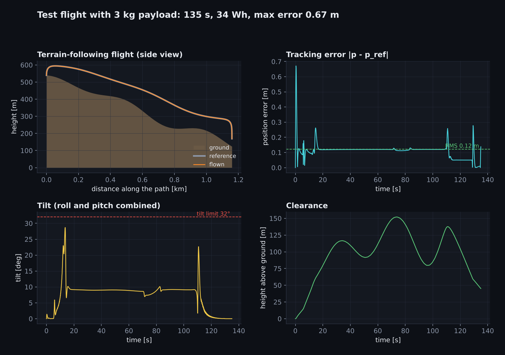

Single test flight with a full load: tracking error RMS 0.12 m, largest 0.67 m, never closer than
36 m to the ground. In gusty wind (single sortie of 1.6 km, full load) the RMS error stays at
0.15 m at 6 m/s and 0.20 m at 9 m/s head wind, and grows to 0.60 m at 12 m/s, which is the limit of this drone:
against more wind it makes almost no headway.

## Studies

Same fires for every row, fast flight model, 15 drones and 3.2 m/s wind unless stated, 30-minute limit.
*Contained* = put out with at most 10 ha burned.

### One fire at a time (120 fires)

60 fires in view of a tower and 60 in blind spots, on the three maps and four terrains.

| Fires | Contained | Mean burned | Median | Worst | Fire seen (median) | First drop (median) | Drops (mean) | Flight (mean) |
|---|---|---|---|---|---|---|---|---|
| in view of a tower | 60 / 60 | 0.4 ha | 0.3 ha | 2 ha | 1 s | 107 s | 3 | 16 drone-min |
| in a blind spot | 57 / 60 | 3.3 ha | 2.4 ha | 12 ha | 49 s | 237 s | 12 | 71 drone-min |

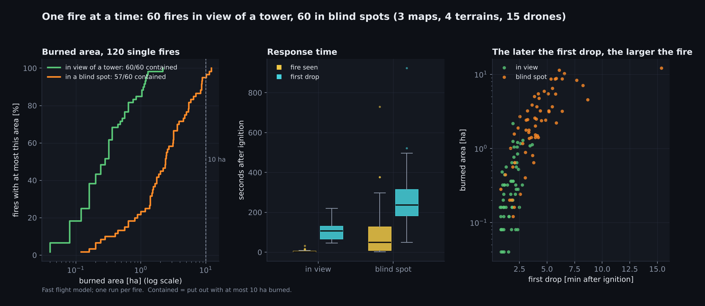

### Several fires at once (24 scenarios)

3 to 5 fires that start together, about half of them in blind spots; 8 scenarios on each map.

| Scenarios | All fires out in 30 min | Mean burned | Median | Worst | Drops | Orders changed in flight | Arrivals with nothing to drop on | Flight |
|---|---|---|---|---|---|---|---|---|
| 24 | 22 / 24 | 14.9 ha | 6.4 ha | 150 ha | 34 | 10.4 | 2.5 | 145 drone-min |

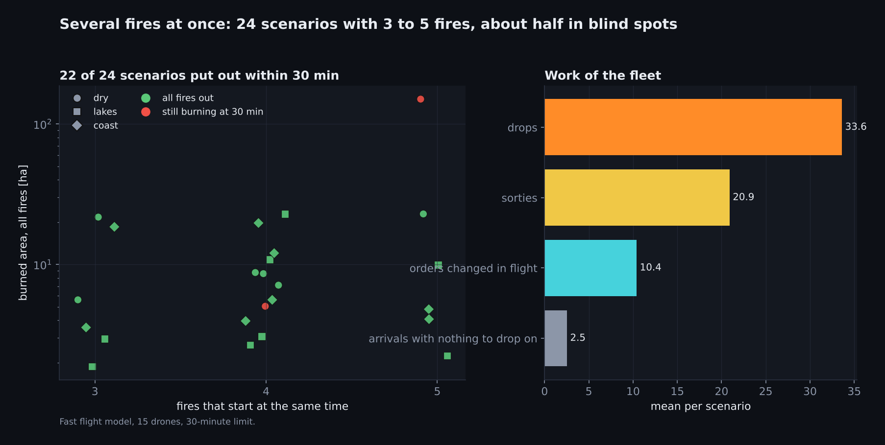

### Fleet size and wind (24 of the single fires)

| Drones | Contained | Mean burned | Median burned | First drop (median) |
|---|---|---|---|---|
| 6 | 20 / 24 | 7.0 ha | 1.2 ha | 151 s |
| 10 | 21 / 24 | 3.3 ha | 1.4 ha | 151 s |
| 15 | 22 / 24 | 2.6 ha | 1.1 ha | 151 s |
| 20 | 22 / 24 | 2.8 ha | 1.1 ha | 150 s |

| Mean wind | Contained | Mean burned | Median burned | First drop (median) |
|---|---|---|---|---|
| 0 m/s | 23 / 24 | 2.7 ha | 0.8 ha | 150 s |
| 3.2 m/s | 22 / 24 | 2.6 ha | 1.1 ha | 151 s |
| 6 m/s | 22 / 24 | 3.2 ha | 1.3 ha | 164 s |
| 10 m/s | 21 / 24 | 3.9 ha | 1.4 ha | 165 s |

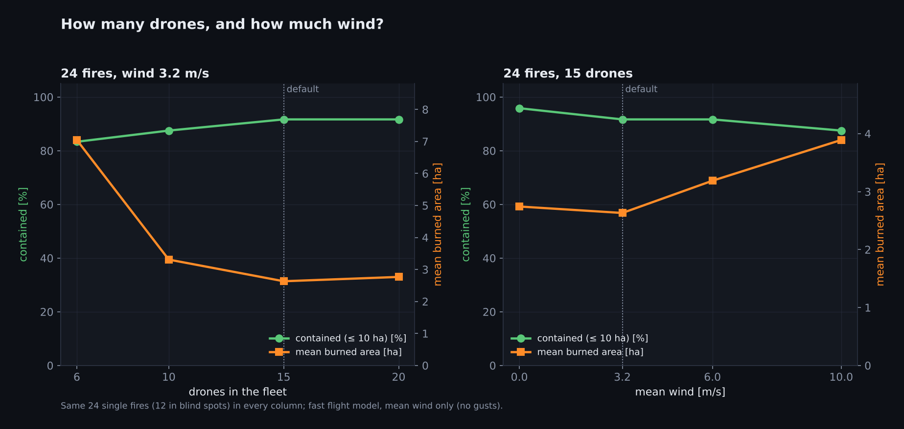

### What the studies say

- **Detection decides.** A fire in view of a tower is reached in about 2 minutes and contained in
  60 of 60 cases; a fire in a blind spot is seen later (median 49 s) and the later the first
  drop, the larger the fire.
- **The fleet works as one.** With several fires, orders are changed in flight 10 times per scenario on
  average, so few drones (2.5 per scenario) arrive with nothing left to drop on.
- **Fleet size has a knee.** With 6 drones the mean burned area is 7.0 ha, with 15 it is
  2.6 ha; more than 15 brought no further gain on these fires.
- **Wind costs time on both sides**: from calm to 10 m/s the mean burned area grows from
  2.7 to 3.9 ha, because the fire spreads faster downwind and the
  drones fly slower against it.
- These are 24 to 120 fires per row: a difference of one or two fires is noise.

## Limitations

- **Not calibrated.** The fire model is a simple cellular automaton, not validated against real fire behaviour.
  Absolute numbers (hectares, minutes) mean nothing for real fires; only relative trends are of interest.
- **The suppressant is simplified and optimistic.** A drop of 1.5 kg acts on a 45 m radius with a 90 % success
  probability. Real aerial firefighting uses far larger quantities per metre of fire line; the drop is a parameter
  here, not a claim about what a small drone can put out.
- **The centre knows the terrain, the wind and the spread rule** (not the fuel). With a real fire the forecast
  would be much less accurate.
- **Smoke detection is a simple rule**: no wind shear, no haze, no false alarms. Deep blind spots are found late.
- **The radio is ideal**: no loss, no range limit; the drones do not negotiate among themselves.
- **Simple wind**: one mean vector plus gusts; no flow over ridges, no updraft over the fire. The fast model used in
  the studies has the mean wind only.
- **Idealised world**: no smoke in the cameras' way, no GPS errors, no collision avoidance between drones, no
  obstacles, no failures. Aircraft are not simulated.
- **Generic drone**: payload, battery and endurance are plausible but not those of a specific product.

## Methods and tests

Python (NumPy, SciPy, Matplotlib, pygame). 45 automated tests: terrain and the three maps, fire behaviour and water,
viewsheds and smoke bearings, flight dynamics and controller robustness in wind and gusts, guidance, the centre's
forecast and drop values, the search for smoke, in-flight re-assignment, refilling at docks and water, agreement
between the two flight models, the flight home, and the simulation window driven without a screen (free play and a
saved scenario).
